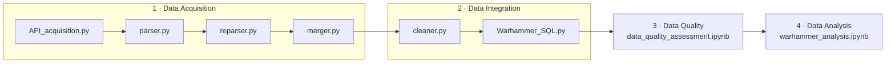

<h1 align="center">Warhammer 40K Tournament Analysis</h1>

<p align="center"><b>Does Army Cost Impact Competitive Performance?</b></p>

<p align="center">
  
  
  
  
  <a href="DM_project__warhammer_40k.pdf"></a>
</p>

<p align="center">
  <a href="#research-questions">Research questions</a> ·
  <a href="#key-findings">Key findings</a> ·
  <a href="#data-sources">Data sources</a> ·
  <a href="#repository-structure">Structure</a> ·
  <a href="#pipeline">Pipeline</a> ·
  <a href="#limitations">Limitations</a> ·
  <a href="#authors">Authors</a>
</p>

---

Data management and analysis project on the **Warhammer 40,000 World Championship 2025** (Atlanta, GA). Tournament results for 402 players are collected via REST API, integrated with retail miniature prices, stored in a relational SQLite database and analysed to find out whether money buys victory.

Developed for the **Data Management** course, MSc in Data Science, University of Milano-Bicocca. Full methodology and results are available in the [project report](DM_project__warhammer_40k.pdf).

| 402 | 40 | 19 | 1 |
|:---:|:---:|:---:|:---:|
| players collected | faction matchups examined | army lists compiled by hand | tournament (November 2025 meta) |

## Research Questions

- 💰 **Economic impact:** does army cost influence results? Is a high budget needed to reach the top tier?
- 📊 **Meta analysis:** do popular factions perform better? Does detachment choice matter?
- ⚔️ **Unit analysis:** do indispensable units exist? Do elite armies beat horde armies?
- 🔄 **Faction dynamics:** is there a "rock-paper-scissors" dynamic between factions?

## Key Findings

| Area | Finding | Evidence |
|---|---|---|
| Economic impact | Army cost has a **weak but statistically significant** positive correlation with performance | cost vs. wins: r = 0.131, p = 0.0086 |
| Economic impact | Top 25 and bottom 25 players spent statistically the same amount: reaching the elite level does not require a bigger budget | p = 0.3082 |
| Meta | Faction popularity is unrelated to win rate, while detachment choice is a key strategic factor within a faction | r = 0.0007 |
| Units | No global advantage for elite or horde lists | n/a |
| Faction dynamics | Only 3 of 40 faction matchups are significant hard counters | 3 of 40 |

> [!NOTE]
> **Bottom line:** Warhammer 40,000 is not pay-to-win. Money gives a marginal advantage, but success is driven mainly by player skill, strategy and preparation.

## Data Sources

| Dataset | Source | Availability |
|---|---|---|
| Tournament data | ListEngine REST API (JSON) | ✅ Processed files included |
| Pricing data | Official price list provided by ArsManufactorea (XLSX, November 2025) | 🔒 Private, not included |

## Repository Structure

```text
.
├── README.md
├── DM_project__warhammer_40k.pdf       # Report
│
├── 1_Data Aquisition/
│   ├── API_acquisition.py              # Extracts raw tournament data from the ListEngine API
│   ├── parser.py                       # First parsing of the raw JSON
│   ├── reparser.py                     # Second parsing pass for failed lists
│   ├── merger.py                       # Merges parsed lists with manually compiled ones
│   ├── validator.py                    # Validation helpers used across the pipeline
│   └── warhammer_manual_lists.json     # 19 manually compiled army lists
│
├── 2_Data Integration/
│   ├── Input/
│   │   ├── warhammer_final_cleaned.json
│   │   └── warhammer_final_valid.json
│   ├── cleaner.py                      # Final cleaning and standardisation
│   ├── Warhammer_SQL.py                # Creates and loads the SQLite database
│   └── warhammer_tournaments.db        # Final relational database
│
├── 3_Data Quality/
│   └── data_quality_assessment.ipynb   # Data quality metrics before/after integration
│
└── 4_Data Analysis/
    └── warhammer_analysis.ipynb        # EDA, statistical tests and visualisations
```

## Pipeline



## Limitations

- Single tournament (November 2025 meta), so results may not generalise.
- Army costs are **estimates** from a rule-based price-scaling function, not actual player spending.
- Small samples in matchup and detachment analyses limit statistical significance.

## Authors

<!-- Optional: link each name to the author's GitHub profile -->

| Author | Contribution |
|---|---|
| **Chiara Mezzanzanica** | Data acquisition and parsing pipeline |
| **Ilaria Cesaratto** | Data cleaning, integration, design and implementation of the SQL database |
| **Andrea Porro** | Statistical analysis and interpretation |

---

<sub>Warhammer 40,000 is a trademark of Games Workshop. This is an independent academic project, not affiliated with or endorsed by Games Workshop.</sub>
